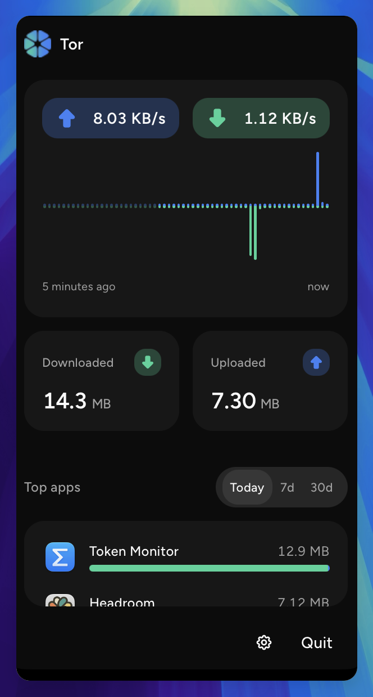
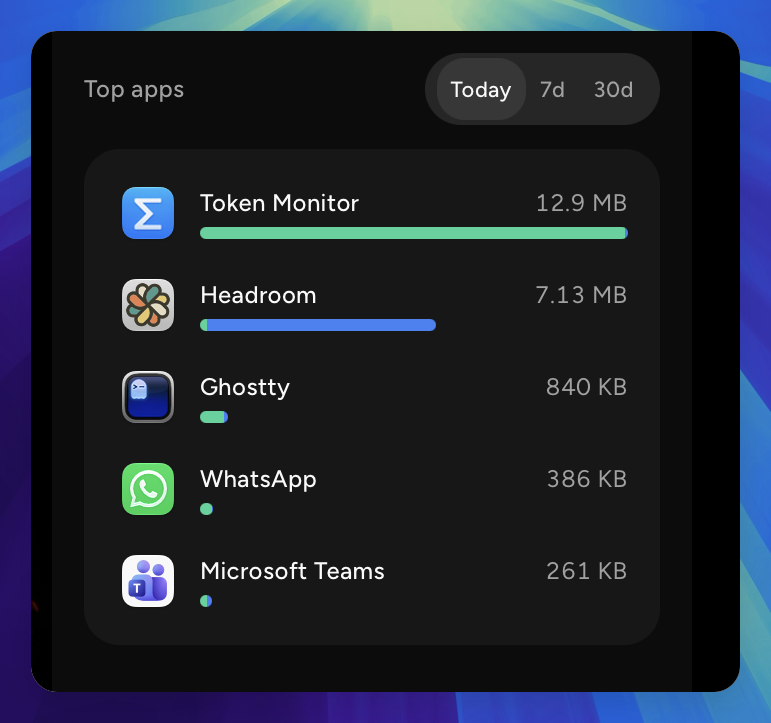
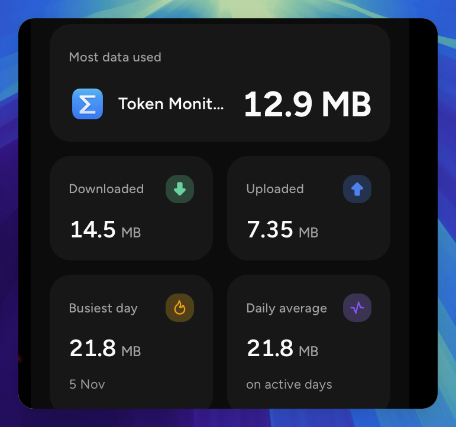

  

<h1 align="center">Tor</h1>

Your internet traffic, at a glance in your menu bar.

  <a href="https://github.com/theCodeD3vil/tor/releases/latest"><strong>Download for macOS</strong></a>

Tor is a network traffic monitor for your Mac. It sits quietly in the menu bar, shows your live upload and download speed, and keeps a record of which apps use your data. Everything is measured and stored locally on your Mac. Nothing ever leaves.

## Installation

Tor runs on macOS, on both Apple Silicon and Intel Macs.

1. Open the [latest release](https://github.com/theCodeD3vil/tor/releases/latest) and download the disk image for your Mac:
   - **Apple Silicon** (M1 or later): `tor-<version>-macos-arm64.dmg`
   - **Intel**: `tor-<version>-macos-x86_64.dmg`

> Not sure which you have? Open the Apple menu › **About This Mac**. A **Chip** line means Apple Silicon; a **Processor** line means Intel.

2. Open the disk image and drag **Tor** into **Applications**.
3. Open Tor from Applications. macOS blocks it the first time, because Tor isn't notarized by Apple yet. Click **Done**, then go to **System Settings › Privacy & Security**, scroll down to the bottom, and click **Open Anyway** next to the message about Tor. You only need to do this once.
4. Tor appears in your menu bar. Click it to open the panel.

Tor keeps itself up to date: when it starts, and then daily, weekly or monthly as you choose, it looks for a new version. When one is found, an **Update available** badge appears in the panel. Click it to read what's new and install. You can change the schedule, or turn automatic checks off, in **Settings › Updates**, and check any time with **Check now**.

## Features

- **Live speed in the menu bar.** The icon shows your current speed, updated every second. Choose what it shows in **Settings › Menubar**: the volume bars, arrows, the Tor logo or nothing, next to the download speed, the upload speed, both, today's total downloaded or uploaded, or the net total.
- **A live chart.** The panel plots the last five minutes of upload and download, with the current speeds above it.
- **Today at a glance.** See how much you have downloaded and uploaded since midnight.
- **Top apps.** See which apps use the most data today, over the last 7 days or over the last 30, with each app's icon. Choose whether the list shows 5, 10 or 20 apps in **Settings › General**. Hover an app and click the eye to hide it from the list and the totals; hidden apps are listed in **Settings › Ignored apps**, where you can bring them back.
- **Stats.** A chart of the last 7, 30 or 90 days, with your most data-hungry app, totals, your busiest day and your daily average.
- **Your units, your colors.** Show speeds in MB/s or Mbps, pick a light, dark or system theme, and choose the download and upload colors from a set of presets.
- **Private by design.** Tor reads your Mac's network counters. It doesn't capture or inspect your traffic, and it has no account or analytics. Your usage history is kept on your Mac for 90 days.

## Good to know

- **Apps are grouped under the app that started them.** Traffic from a program you run in a terminal counts toward the terminal app, and a browser's helper processes count toward the browser.
- **Only traffic that leaves your Mac is counted.** Connections between programs on your own Mac are ignored.
- **VPNs are fine.** Apps are counted whether or not their traffic goes through a VPN, and the VPN's own tunnel isn't counted on top of them. If a VPN still shows up in Top apps, hide it.
- **History starts when you first open Tor.** Longer ranges fill up over time, up to 90 days.
- **Totals and the app list only count while Tor is running.**

## Screenshots

  
   
  <em>Live speed, a five-minute chart and today's totals</em>

  
   
  <em>The apps using the most data, today, this week or this month</em>

  
   
  <em>Your most data-hungry app, totals, busiest day and daily average</em>

